## Hi, I'm Kevin

I'm a Computer Science student at NYU with a minor in Mathematics, graduating in May 2028.
I build full-stack web apps and work on projects in natural language processing, mostly around 
how to evaluate machine translation and LLM output.

---

### Projects

[**NYC 15-Minute City Explorer**](https://github.com/Shen-42/nyc-15min): what you can reach on foot in 15 minutes in NYC ([live](https://www.nyc15min.com/))

[**Toronto Crash Coverage Framing**](https://github.com/Shen-42/media-bias): how Toronto news describes crashes with pedestrians and cyclists ([results](https://shen-42.github.io/media-bias/))

[**Bridge Translator**](https://github.com/Shen-42/bridge-translator): turns bridge game shorthand into plain English ([results](https://shen-42.github.io/bridge-translator/))

[**MT Metrics by Phenomenon**](https://github.com/mrassell/machine-translation-project): which machine translation metrics match human judgments, team project ([paper](https://github.com/mrassell/machine-translation-project/blob/main/final.pdf))

[**Gallbladder Tracker**](https://github.com/Shen-42/gallbladder-tracker): shows which foods came before pain episodes ([demo](https://shen-42.github.io/gallbladder-tracker/))

---

### Tech Stack

---

### GitHub Activity

  <picture>
    <source media="(prefers-color-scheme: dark)" srcset="./profile/stats-dark.svg">
    
  </picture>
  <picture>
    <source media="(prefers-color-scheme: dark)" srcset="./profile/top-langs-dark.svg">
    
  </picture>

<picture>
  <source media="(prefers-color-scheme: dark)" srcset="./profile/streak-dark.svg">
  
</picture>
